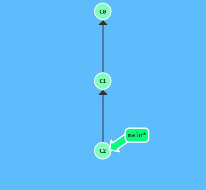
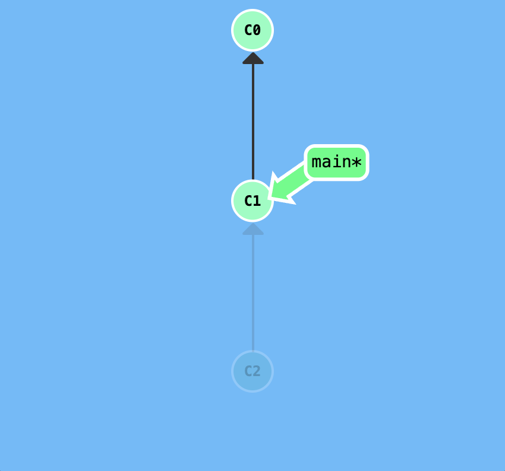
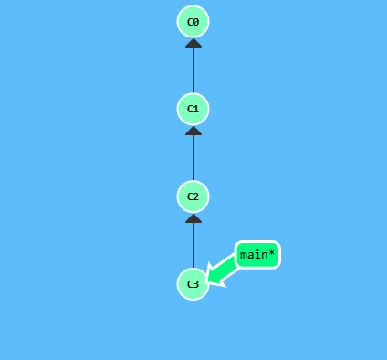
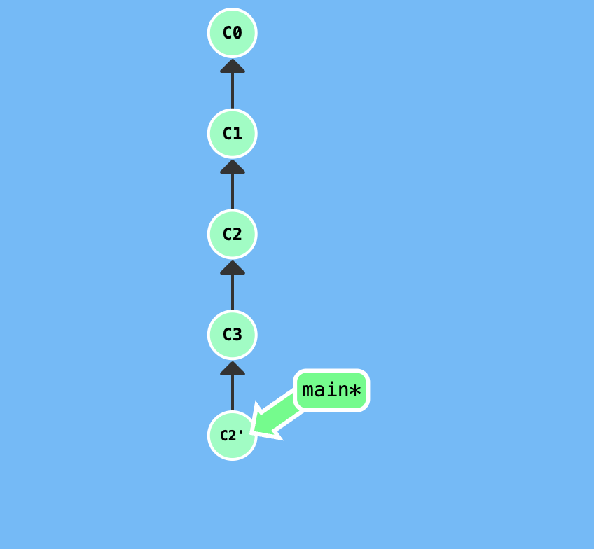
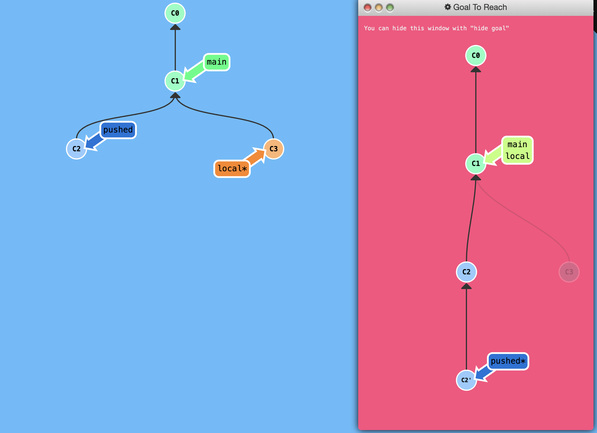

## Reversing Changes

Git has both a low-level component (staging individual files or chunks) and a high-level component (how the changes are actually reversed). 

There are two primary ways to undo changes in Git -- one is using `git reset` and the other is using `git revert`. 

## Git Reset

`git reset` reverses changes by moving a branch reference backwards in time to an older commit. In this sense you can think of it as "rewriting history"; `git reset` will move a branch backwards as if the commit had never been made in the first place.

Let's see what this looks like:

<p align="center">  </p>

```
git reset HEAD~1
```


<p align="center">  </p>

Git moved the main branch reference back to `C1`; now our local repository is in a state as if `C2` had never happened.

## GIt Revert

While resetting works great for local branches on your own machine, its method of "rewriting history" doesn't work for remote branches that others are using.

In order to reverse changes and *share* those reversed changes with others, we need to use `git revert`


<p align="center">  </p>

```
git revert HEAD^
```

<p align="center">  </p>

## Puzzle

To complete this level, reverse the most recent commit on both `local` and `pushed`. Keep in mind that `pushed` is a remote branch and `local` is a local branch.


<p align="center">  </p>

## Solution

```
git checkout local
git reset HEAD~1
git checkout pushed
git revert HEAD
```