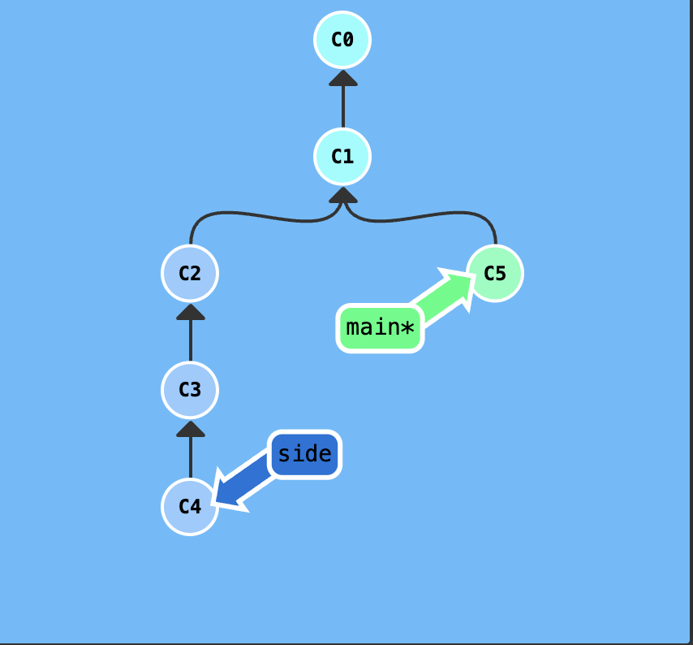
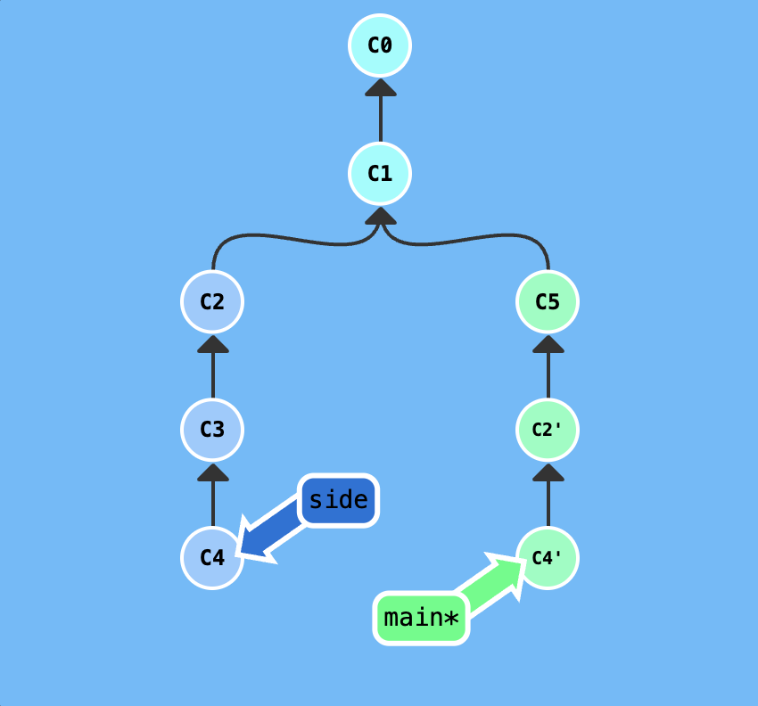
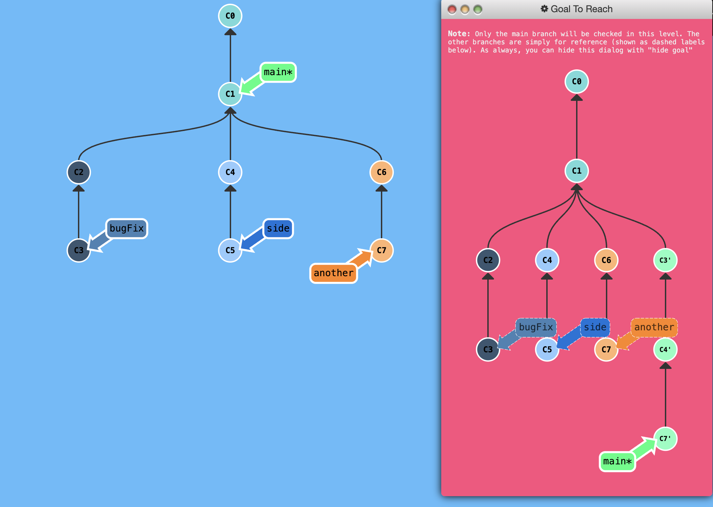

## Git Cherry-pick

* `git cherry-pick <Commit1> <Commit2> <...>

It is a straightforward way of saying that you would like to copy a series of commits below your current location (`HEAD`). 

## Demonstration

Here's a repository where we have some work in branch `side` that we want to copy to `main`. This could be accomplished through a rebase (which we already have learned) but let's see how cherry-pick performs.

<p align="center">  </p>

```
git cherry-pick C2 C4
```

<p align="center">  </p>
## Puzzle

<p align="center">  </p>

## Solution

```
git cherry-pick C3 C4 C7
```