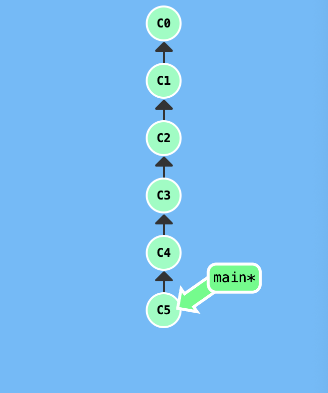
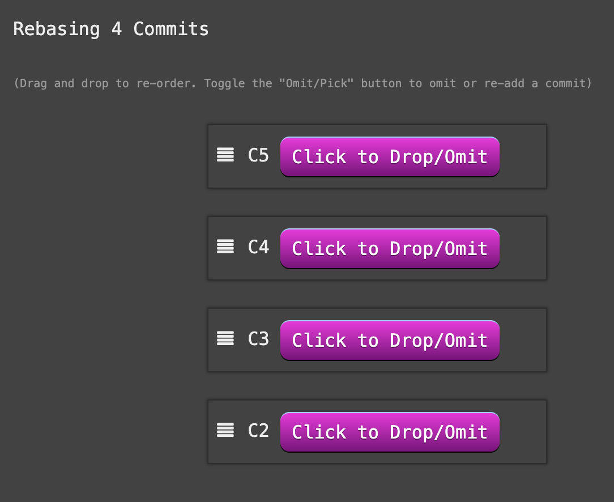
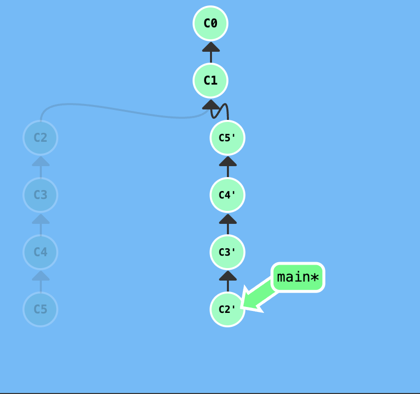
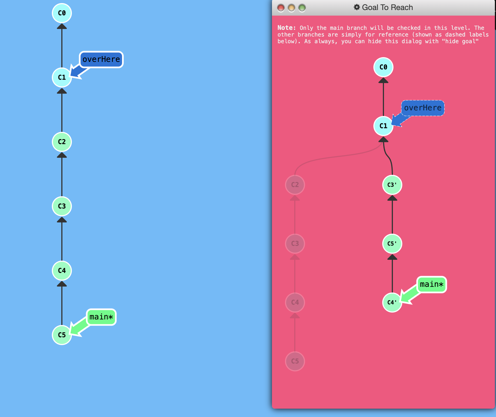

## Git Interactive Rebase

Git cherry-pick is great when you know which commits you want (and you know their corresponding hashes) -- it's hard to beat the simplicity it provides.

But ... what about the situation where you don't know what commits you want?

Thankfully, git has you covered there as well. We can use interactive rebasing for this -- it's the best way to review a series of commits you're about to rebase.

Interactive rebase means that Git is using the `rebase` command with the `-i` option.

If you include this option, git will open up a UI to show you which commits are about to be copied below the target of the rebase. It also shows their commit hashes and messages, which is great for getting a bearing on what's that.

For "real" git, the UI windows means opening up a file in a text editor like `vim`. For our purposes, we're going to be using a small dialog window that behaves the same way.

When the interactive rebase dialog opens, you have the ability to do two things in our educational application:

- You can reorder commits simply by changing their order in the UI (via dragging and dropping the mouse)

- You can choose to keep all commits or drop specific ones. When the dialog opens, each commit is set to be included by the `pick` button next to it being active. To drop a commit, toggle off its `pick` button.

It is worth mentioning that in the real git interactive rebase you can do many more things like squashing (combining) commits, amending commit messages, and even editing the commits themselves. For our purposes though we will focus on these two operations above.

## Demonstration

When you input the command `git rebase -i HEAD~4` you can reorder some commits around and see the result!

<p align="center">  </p>

<p align="center">  </p>
> This rebasing dialogue reordering menu would be in a `vim` text editor in real git.


<p align="center">  </p>

As you can see, Git copied down commits in the same exact way as I specified through the UI.

## Puzzle

<p align="center">  </p>

```
	git rebase -i overHere
	
	# Omit C2, and order C3 C5 C4 
```

