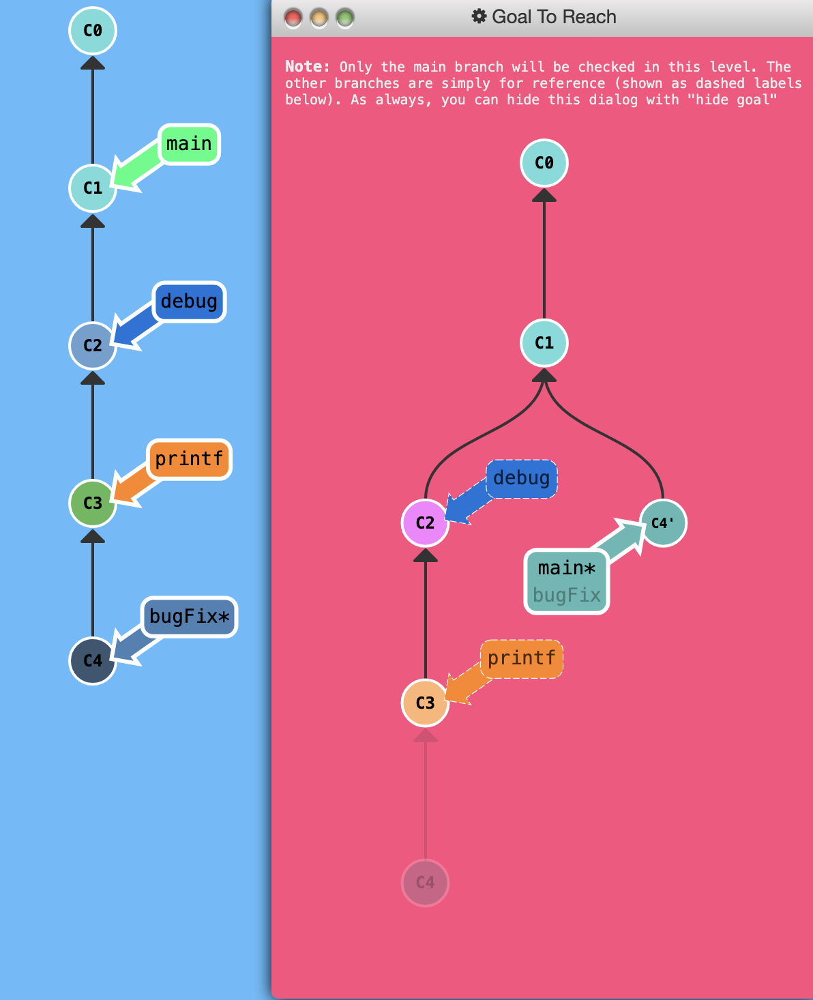

## Locally stacked commits

Imagine this: you're trying to track down a bug but it is quite elusive. In order to aid in your detective work, there are a few debug commands and a few print statements that you can use.

All of those debugging / print statements are in their own commits. 

Only problem is that you need to get `bugFix` back into the `main` branch. If I simply fast-forwarded `main`, then `main` would get all my debug statements which is desirable. There has to be another way.....

We need to tell git to copy one of the commits over. This is just like the levels earlier on moving work around we can use the same commands:

* `git rebase -i`
* `git cherry-pick`

## Puzzle

<p align="center">  </p>

## Solution

```
git rebase -i main # Omit C2 and C3
git rebase bugFix main
```