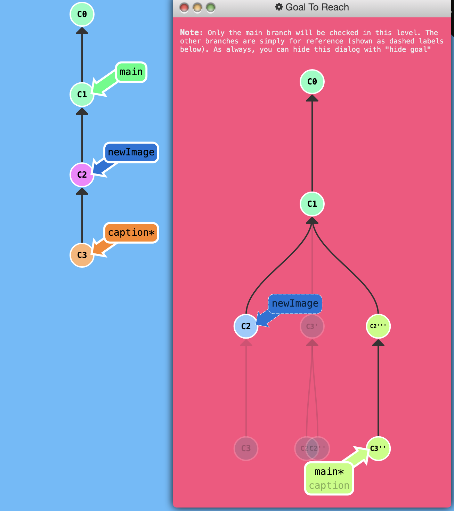

## Juggling Commits

Here's another situation that happens quite frequently. You have some changes (`newImage`) and another set of changes (`caption`) that are related, so they are stacked on top of each other in your repository (aka one after another).

Tricky thing is that sometimes you need to make a small modification to an earlier commit. In this case, design wants us to change the dimensions of `newImage` slightly, even though that commit is way back in our history!!

We can overcome this difficulty by the following:

- We will re-order the commits so the one we want to change is on top with `git rebase -i`

- We will `git commit --amend` to make the slight modification

- Then we will re-order the commits back to how they were previously with `git rebase -i`

- Finally, we will move main to this updated part of the three to finish the level (via the method of your choosing)

## Puzzle

<p align="center">  </p>

## Solution
```
git rebase -i HEAD~2 # Order is C3, C2 
git commit --amend
git rebase -i HEAD~2 # Order is C2'', C3'
git rebase caption main
```